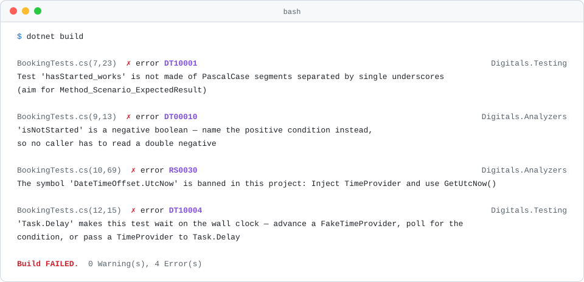
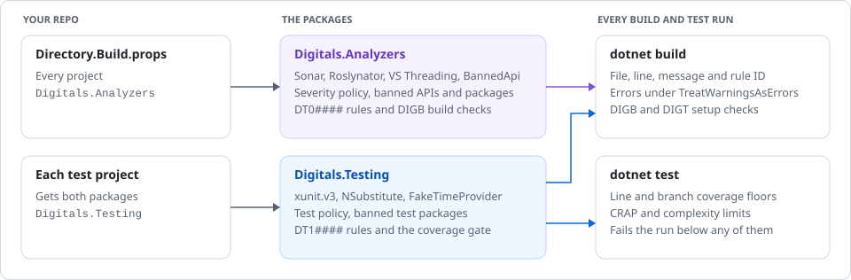

<h1 align="center">Digitals C# Conventions</h1>

<p align="center">
  The Digitals C# rules for every .NET repo, as two NuGet packages.<br>
  One for production code, one for test projects. Reference them and the build enforces the rest.
</p>

<p align="center">
  <a href="https://www.nuget.org/packages/Digitals.Analyzers"></a>
  <a href="https://www.nuget.org/packages/Digitals.Testing"></a>
  <br>
  <a href="https://github.com/Digitals-OYT-Ltd/csharp-conventions/actions/workflows/analyzers.yml"></a>
  <a href="https://github.com/Digitals-OYT-Ltd/csharp-conventions/actions/workflows/testing.yml"></a>
  
  <a href="LICENSE"></a>
</p>

<p align="center">
  <a href="#quick-start">Quick start</a> ·
  <a href="#the-packages">The packages</a> ·
  <a href="#the-coverage-gate">Coverage gate</a> ·
  <a href="#run-it-in-ci">CI</a> ·
  <a href="#turning-something-off">Opting out</a> ·
  <a href="#contributing">Contributing</a>
</p>

<p align="center">
  <picture>
    <source media="(prefers-color-scheme: dark)" srcset="docs/images/build-dark.svg">
    
  </picture>
</p>

Every Digitals .NET repo builds with the same analyzers, the same severities and the same test stack. These two packages carry them, so a repo references a package instead of wiring up eleven analyzer and test packages and copying an `.editorconfig` around.

- Nothing to import. Each package ships `build/` files that NuGet loads into the project on restore: the severity policy, the banned APIs, the build checks, the coverage settings.
- One version to review. Every bundled analyzer and test package is pinned inside. An upgrade is one version bump and one changelog, in every repo at once.
- Warnings, not errors. Every rule ships as a warning or a suggestion, and the repo's `TreatWarningsAsErrors` decides how hard it bites. The package checks that it is on.
- Production and tests apart. Test projects get a looser policy where the production rules fight the way tests are written, and nothing about tests reaches production code.

## Quick start

Reference `Digitals.Analyzers` once, in `Directory.Build.props`, so it reaches every project:

```xml
<Project>
  <PropertyGroup>
    <Nullable>enable</Nullable>
    <TreatWarningsAsErrors>true</TreatWarningsAsErrors>
    <WarningsAsErrors>nullable</WarningsAsErrors>
    <EnforceCodeStyleInBuild>true</EnforceCodeStyleInBuild>
    <GenerateDocumentationFile>true</GenerateDocumentationFile>
  </PropertyGroup>
  <ItemGroup>
    <PackageReference Include="Digitals.Analyzers" PrivateAssets="all" />
  </ItemGroup>
</Project>
```

Reference `Digitals.Testing` in each test project, and nothing else from the test stack:

```xml
<ItemGroup>
  <PackageReference Include="Digitals.Testing" />
</ItemGroup>
```

Select the Microsoft.Testing.Platform runner in `global.json`:

```json
{
  "sdk": { "version": "10.0.100", "rollForward": "latestMinor" },
  "test": { "runner": "Microsoft.Testing.Platform" }
}
```

Neither reference has a `Version`: both assume central package management, with the versions in
`Directory.Packages.props`. Without it, add `Version` to each reference.

Then `dotnet build` runs every rule and `dotnet test` collects coverage and judges it. Moving an existing repo over, including how to stage the first wave of findings: [Digitals.Analyzers](docs/adoption/analyzers.md) and [Digitals.Testing](docs/adoption/testing.md).

## The packages

| | [`Digitals.Analyzers`](src/Digitals.Analyzers/README.md) | [`Digitals.Testing`](src/Digitals.Testing/README.md) |
| --- | --- | --- |
| Reference it from | `Directory.Build.props` | Each test project |
| Covers | Every project | Test projects only |
| Bundles | SonarAnalyzer.CSharp, Roslynator, VS Threading analyzers, BannedApiAnalyzers | xunit.v3, NSubstitute, FakeTimeProvider, Microsoft's coverage engine, the TRX reporter |
| Severity policy | `global_level 100` | `global_level 300`, relaxing what fights tests |
| Banned | The ambient clock and `int` millisecond delays everywhere; raw SQL, raw HTML and one-string process arguments in production code; `Newtonsoft.Json`, AutoMapper, EF6, `System.Data.SqlClient` | The VSTest stack, Moq, FluentAssertions, xUnit v2, NUnit, MSTest |
| Own rules | `DT0####`: time types, `HttpClient`, naming, one abstraction level per method | `DT1####`: test names, category traits, wall-clock waits, tests without an assertion |
| Build checks | `DIGB001` to `DIGB004` | `DIGT001`, `DIGT002` |
| Gates | | Coverage floors, CRAP limit, complexity cap |
| Every rule explained | [Analyzers rules](docs/rules/analyzers.md) | [Testing rules](docs/rules/testing.md) |

Every rule has its own section on the rules page for [Digitals.Analyzers](docs/rules/analyzers.md) or [Digitals.Testing](docs/rules/testing.md): why it exists, a failing and a passing example, and the message the build prints.

A test project gets both packages: `Digitals.Analyzers` through `Directory.Build.props`, `Digitals.Testing` through its own reference. The two own separate ID ranges, `DT0####` and `DT1####`, so one `#pragma` never silences two unrelated rules.

## How it works

<picture>
  <source media="(prefers-color-scheme: dark)" srcset="docs/images/how-it-works-dark.svg">
  
</picture>

NuGet imports `build/<PackageId>.props` and `.targets` from each package into the project that references it. The `.props` adds a global AnalyzerConfig with the severities and the analyzer inputs; the `.targets` runs the build checks and passes the coverage options to the test run. The packages' own rules are Roslyn analyzers packed into `analyzers/dotnet/cs/`, built against Roslyn 5.0.0, the version the .NET 10.0.100 SDK ships.

The coverage gate is a Microsoft.Testing.Platform extension inside `Digitals.Testing`. It reads the Cobertura reports the run writes and fails the run from inside the test host, because under .NET 10's `dotnet test` no MSBuild target runs after the tests.

## The coverage gate

Every `dotnet test` collects coverage and judges it, with no flags. The defaults:

| Setting | Default | Judged |
| --- | --- | --- |
| `DigitalsMinLineCoverage` | `100` | Across the run |
| `DigitalsMinBranchCoverage` | `100` | Across the run |
| `DigitalsMaxCrapScore` | `30` | Per method |
| `DigitalsMaxCyclomaticComplexity` | `20` | Per method |

Below a floor, the run fails with the numbers:

```console
$ dotnet test
Line coverage 82.4% is below the 100.0% floor (416 of 505 covered). Add tests; do not lower the floor.
```

Each one is a ratchet. A repo adopting the package lowers it once, next to a comment naming what raises it back, then moves it up as coverage climbs. The [Testing rules page](docs/rules/testing.md#coverage-gate) covers each limit and its switch.

## Run it in CI

The packages need nothing in the pipeline beyond `dotnet build` and `dotnet test`. A finding fails the build, a missed floor fails the test step, and the TRX report lands in each test project's `TestResults/`:

```yaml
- uses: actions/checkout@v5
- uses: actions/setup-dotnet@v5
  with:
    global-json-file: global.json
- run: dotnet build --configuration Release
- run: dotnet test --configuration Release --no-build
```

`dotnet build` prints warnings and errors only. To get the `suggestion` level findings too, in SARIF for a script or a coding agent to read:

```bash
dotnet build -p:DigitalsSarifDir=artifacts/sarif
```

## Turning something off

A repo-local `.editorconfig` beats both packaged policies. That is the supported opt-out, not a workaround:

```ini
[*.cs]
dotnet_diagnostic.S1234.severity = none
```

For one line, suppress it with the reason beside it:

```csharp
#pragma warning disable RS0030 // Bootstrap logging runs before the container is built
Log.Information("Starting at {Now}", DateTimeOffset.UtcNow);
#pragma warning restore RS0030
```

Each build check and gate has its own switch, such as `DigitalsAllowBannedPackages`, `DigitalsAllowVSTestRunner` or `DigitalsSkipCoverageGate`. The rules pages list them all.

## Contributing

You need the .NET 10 SDK, [just](https://github.com/casey/just) and PowerShell 7.

| Command | What it does |
| --- | --- |
| `just test [package]` | Every test project, or one package's: `just test Analyzers` |
| `just format-check` | The formatting check; CI runs the same check, scoped to the package. `just format` fixes it |
| `just pack [package]` | Every package into `artifacts/`, or one: `just pack Testing` |
| `just check-ledger [package]` | Fails while an `AnalyzerReleases.Unshipped.md` still lists a rule |
| `just clean` | Removes every `bin/`, `obj/`, `artifacts/` and `TestResults/` |

A change to a package's `build/` folder also needs a scratch consumer built against the packed nupkg, since no unit test sees it. [AGENTS.md](AGENTS.md) and the `AGENTS.md` beside each package cover where a rule goes, how to test it, and the Roslyn and NuGet quirks that cost time.

```txt
src/Digitals.Analyzers/           the package: vendor analyzer references and build/, the policy and the DIGB checks
src/Digitals.Analyzers.CSharp/    the DT0#### rules, packed into Digitals.Analyzers
src/Digitals.Testing/             the package: the test stack and build/, the test policy, the coverage settings, the DIGT checks
src/Digitals.Testing.CSharp/      the DT1#### rules, packed into Digitals.Testing
src/Digitals.Testing.Coverage/    the coverage gate, a Microsoft.Testing.Platform extension
tests/                            one test project per assembly: the two rule sets and the coverage gate
docs/rules/                       every rule explained, one page per package
docs/adoption/                    moving an existing repo onto each package
```

### Releasing

Each package releases on its own tag. Its workflow in `.github/workflows/` tests it, checks its release ledger, packs it, pushes it to nuget.org through Trusted Publishing and creates a GitHub Release.

```bash
git tag analyzers/vX.Y.Z && git push origin analyzers/vX.Y.Z    # or testing/vX.Y.Z
```

Before tagging, move the package's new rules from `AnalyzerReleases.Unshipped.md` to `Shipped.md` under the version heading. MinVer versions each package from its own tags only. A bump of any bundled package is at least a minor release.

### Security

Report a vulnerability privately, as [SECURITY.md](SECURITY.md) describes. Dependabot proposes version bumps weekly, and `.github/workflows/security.yml` opens an issue when a pinned package has a known vulnerability.

## Licence

[MIT](LICENSE). This covers the code in this repository: the config files, the build checks, the coverage gate and the `DT#####` analyzers. The bundled analyzers and test packages keep their own licences and reach you as ordinary NuGet dependencies.
