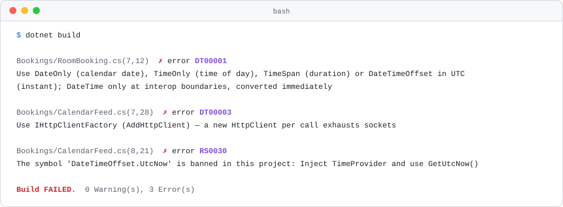
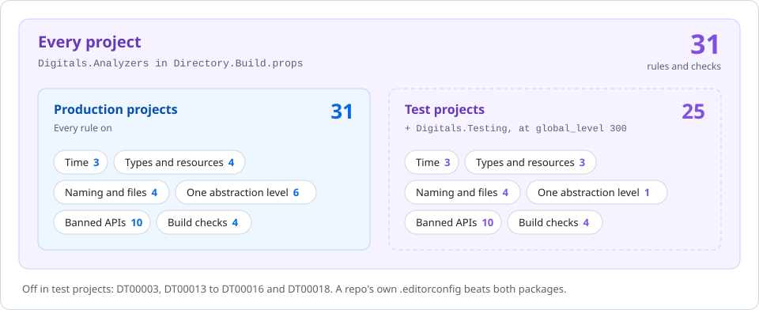

<h1 align="center">Analyzer rules</h1>

<p align="center">Every rule Digitals.Analyzers adds to a C# build, why it exists, and what fixes it.</p>

<p align="center">
  
  
  
</p>

<p align="center">
  <a href="#how-to-read-a-rule">How to read a rule</a> ·
  <a href="#the-rules">The rules</a> ·
  <a href="#severity-policy">Severity policy</a> ·
  <a href="#change-a-rule-for-one-repo">Change a rule</a> ·
  <a href="../../README.md">Back to the README</a>
</p>

<p align="center">
  <picture>
    <source media="(prefers-color-scheme: dark)" srcset="../images/rules-analyzers-dark.svg">
    
  </picture>
</p>

Digitals.Analyzers is one NuGet package that brings the Digitals C# rules to a repo. It bundles four vendor analyzer
packs (Sonar, Roslynator, the threading analyzers and the banned-API analyzer), sets their severities, and adds rules
of its own. Reference it once in `Directory.Build.props` and it reaches every project:

```xml
<PackageReference Include="Digitals.Analyzers" PrivateAssets="all" />
```

This page covers what the package adds itself: the `DT0####` Roslyn rules, the APIs it bans through `RS0030`, and the
`DIGB` checks it runs before a build. The [severity policy](#severity-policy) at the end says which vendor rules it
raises to a warning and which it turns down to a suggestion. A finding prints its file, line and column, the rule ID and
the message, so search this page for the ID.

The examples are small projects: bookings for meeting rooms, orders, invoices and a storefront.
Each was built against Digitals.Analyzers 0.11.0, and each fix was built again to check it passes.

## Where the rules apply

<p align="center">
  <picture>
    <source media="(prefers-color-scheme: dark)" srcset="../images/rules-analyzers-scope-dark.svg">
    
  </picture>
</p>

| Scope | Rules | How |
| --- | --- | --- |
| Every project | `DT00001`, `DT00002`, `DT00004`, `DT00006` to `DT00012`, `DT00017`, the clock and millisecond bans and the build checks | Digitals.Analyzers in `Directory.Build.props` reaches production and test projects alike |
| Production code | `DT00003`, `DT00013` to `DT00016`, `DT00018`, the raw SQL, raw HTML and command line bans | Digitals.Testing, which only test projects reference, turns the rules off at `global_level = 300` and drops the ban list from the build |

A test builds an `HttpClient` over a stub handler to test a `DelegatingHandler`, repeats its act-and-assert steps, builds
its inputs field by field, runs as long as its scenario needs, and reads files directly, all on purpose. So those six
rules stay in production code. So do the raw SQL, raw HTML and command line bans, since test cleanup runs fixed SQL
against table names built at runtime. `DT00017` stays on in tests, which check results with assertions rather than an inline
throw. Digitals.Testing relaxes some vendor rules too; [testing.md](testing.md) lists them.

## How to read a rule

Every rule below has the same parts:

- Two badges.  runs in production and test projects;  is turned off in test projects by Digitals.Testing. The second badge says where the rule comes from. Every rule on this page is a Digitals rule; the vendor rules are in the [severity policy](#severity-policy).
- Why the rule exists.
- A diff. The red lines fail the rule, the green lines pass it.
- What `dotnet build` prints for the red lines, captured from a real build. The path is cut to the project folder, and the
  trailing `[…/X.csproj]` is dropped. The builds ran with `TreatWarningsAsErrors` off so that every finding prints as a
  `warning`; with the org setting on, the same line says `error`.

`DT00006` and `DT00011` are suggestions, and `dotnet build` never prints a suggestion. Their lines come from the SARIF log
the package writes with `dotnet build -p:DigitalsSarifDir=sarif`, printed in the same shape with `note` in place of
`warning`. The build checks are MSBuild errors, so their lines point at the package's targets file instead of your code.

## The rules

| Topic | Rules |
| --- | --- |
| [Time](#time) | [`DT00001`](#dt00001) · [`DT00002`](#dt00002) · [`DT00007`](#dt00007) |
| [Types and resources](#types-and-resources) | [`DT00003`](#dt00003) · [`DT00004`](#dt00004) · [`DT00006`](#dt00006) · [`DT00008`](#dt00008) |
| [Naming and files](#naming-and-files) | [`DT00009`](#dt00009) · [`DT00010`](#dt00010) · [`DT00011`](#dt00011) · [`DT00012`](#dt00012) |
| [One abstraction level](#one-abstraction-level) | [`DT00013`](#dt00013) · [`DT00014`](#dt00014) · [`DT00015`](#dt00015) · [`DT00016`](#dt00016) · [`DT00017`](#dt00017) · [`DT00018`](#dt00018) |
| [Banned APIs](#banned-apis) | [`RS0030` ambient clock](#rs0030-ambient-clock) · [`RS0030` millisecond overloads](#rs0030-millisecond-overloads) · [`RS0030` raw SQL](#rs0030-raw-sql) · [`RS0030` raw HTML](#rs0030-raw-html) · [`RS0030` command lines](#rs0030-command-lines) |
| [Build checks](#build-checks) | [`DIGB001`](#digb001) · [`DIGB002`](#digb002) · [`DIGB003`](#digb003) · [`DIGB004`](#digb004) |

## Time

### `DT00001`

 

No `System.DateTime`, anywhere, including a bare property declaration. A `DateTime` doesn't say whether it is UTC, local
or neither, and the `Kind` it carries is lost on the way through most serialisers and databases. Use the type that says
what the value is: `DateOnly` for a calendar date, `TimeOnly` for a time of day, `TimeSpan` for a duration, and
`DateTimeOffset` in UTC for an instant. `DateTime` is allowed only at an interop boundary, converted straight away, with a
`#pragma` that says so.

```diff
  public sealed class Booking
  {
-     public DateTime StartsAt { get; init; }
+     public DateTimeOffset StartsAt { get; init; }
  }
```

```text
Bookings/Booking.cs(5,12): warning DT00001: Use DateOnly (calendar date), TimeOnly (time of day), TimeSpan (duration) or DateTimeOffset in UTC (instant); DateTime only at interop boundaries, converted immediately
```

> **Note:** A `using Stamp = System.DateTime;` alias is reported once, on the alias line, and not where `Stamp` is used. The rule has its own ID rather than reusing `RS0030`, so a `#pragma` for an interop `DateTime` never also switches off the clock ban.

### `DT00002`

 

No `DateTimeOffset.LocalDateTime` or `DateTimeOffset.DateTime`. Both quietly hand back a `DateTime`, which `DT00001`
can't see because the type is never written. `LocalDateTime` shifts the value into the server's time zone. Where a
boundary needs a `DateTime`, convert with `.UtcDateTime`. It holds the same ticks as `.DateTime` at offset zero, but its
`Kind` is `Utc`, so a round-trip `"O"` string gains a `Z`: check what reads it.

```diff
  public static class LegacyCalendar
  {
-     public static long StartTicks(DateTimeOffset startsAt) => startsAt.DateTime.Ticks;
+     public static long StartTicks(DateTimeOffset startsAt) => startsAt.UtcDateTime.Ticks;
  }
```

```text
Bookings/LegacyCalendar.cs(5,72): warning DT00002: 'DateTimeOffset.DateTime' reintroduces an ambient-zone DateTime; convert at boundaries with UtcDateTime
```

### `DT00007`

 

No class of your own that derives from `System.TimeProvider`. A hand-made clock for tests usually overrides fewer
members than the code under test calls, and it can't be advanced. Use `FakeTimeProvider` from
`Microsoft.Extensions.TimeProvider.Testing` in tests and `TimeProvider.System` in production. A class that derives from
`FakeTimeProvider` to add helpers is fine.

```diff
- public sealed class FixedClock(DateTimeOffset now) : TimeProvider
- {
-     public override DateTimeOffset GetUtcNow() => now;
- }
+ var clock = new FakeTimeProvider(new DateTimeOffset(2026, 3, 2, 9, 0, 0, TimeSpan.Zero));
```

```text
Bookings/FixedClock.cs(3,21): warning DT00007: 'FixedClock' derives from TimeProvider — use FakeTimeProvider (Microsoft.Extensions.TimeProvider.Testing) in tests, TimeProvider.System in production
```

## Types and resources

### `DT00003`

 

No `new HttpClient()`. A client created per call holds its socket open after it is disposed, so a busy service runs out
of sockets, and a client kept forever never sees a DNS change. Register a typed client with `AddHttpClient` and take
`HttpClient` in the constructor; `IHttpClientFactory` manages the handlers. Target-typed `HttpClient client = new();` is
caught too.

```diff
- public sealed class ExchangeRates
+ public sealed class ExchangeRates(HttpClient client)
  {
-     public async Task<string> GetAsync(Uri source, CancellationToken cancellationToken)
-     {
-         using var client = new HttpClient();
-         return await client.GetStringAsync(source, cancellationToken);
-     }
+     public async Task<string> GetAsync(Uri source, CancellationToken cancellationToken) =>
+         await client.GetStringAsync(source, cancellationToken);
  }
```

```text
Storefront/ExchangeRates.cs(7,28): warning DT00003: Use IHttpClientFactory (AddHttpClient) — a new HttpClient per call exhausts sockets
```

The client is registered with `services.AddHttpClient<ExchangeRates>();`.

### `DT00004`

 

No `dynamic`. Every member access on it is resolved at run time, so a renamed property or a wrong type compiles and
fails in production. Resolve the type at compile time with a typed model, a generic or an injected service. A type of
your own that happens to be called `dynamic` isn't reported.

```diff
  public static class OrderTotals
  {
-     public static decimal Total(dynamic order) => order.Total;
+     public static decimal Total(Order order) => order.Total;
  }
```

```text
Orders/OrderTotals.cs(5,33): warning DT00004: Resolve types at compile time — generics, DI, or a typed model instead of dynamic
```

### `DT00006`

 

Money is `decimal`, never `double` or `float`. Binary floating point can't hold 0.10 exactly, so totals drift by a cent.
The rule guesses from the name: a field, property or parameter of type `double` or `float` whose name contains `price`,
`cost`, `amount`, `fee`, `charge`, `payment`, `refund`, `balance`, `salary`, `tax` or `discount`. Because it is a guess,
it is a suggestion: it shows in the IDE and never fails a build.

```diff
  public sealed class InvoiceLine
  {
-     public double UnitPrice { get; init; }
+     public decimal UnitPrice { get; init; }
  }
```

```text
Invoices/InvoiceLine.cs(5,19): note DT00006: 'UnitPrice' looks like a money value held as double — binary floating point loses cents; use decimal
```

### `DT00008`

 

A method never returns a nullable collection. To a caller, `null` and empty mean the same thing, nothing to loop over,
so the `?` adds no information and costs a null check at every call site. Return `[]` or `Array.Empty<T>()`. The rule
looks inside `Task<T>` and `ValueTask<T>`, and covers arrays, `ImmutableArray<T>?` and `IAsyncEnumerable<T>`.
`string?` is left alone, and so are properties and fields.

```diff
  public interface IOrderStore
  {
-     Task<IReadOnlyList<Order>?> FindByCustomerAsync(Guid customerId, CancellationToken cancellationToken);
+     Task<IReadOnlyList<Order>> FindByCustomerAsync(Guid customerId, CancellationToken cancellationToken);
  }
```

```text
Orders/IOrderStore.cs(5,33): warning DT00008: 'FindByCustomerAsync' returns a nullable collection — null and empty mean the same thing to a caller; return an empty collection instead
```

## Naming and files

### `DT00009`

 

No `#region`, named or not, at any depth. A region folds code out of sight, so a type grows past its job without anyone
noticing, and the standard member order stops being visible. If a file needs sections, it needs to be two types or two
methods. Generated code is exempt.

```diff
  public sealed class Invoice
  {
-     #region Totals
      public decimal Net { get; init; }

      public decimal Tax { get; init; }
-     #endregion
  }
```

```text
Invoices/Invoice.cs(5,5): warning DT00009: Delete the #region — extract a type or a method instead of folding the code away
```

### `DT00010`

 

A boolean is named for the affirmative. With `IsNotBookable`, every caller writes `!room.IsNotBookable`, a double
negative. The rule reports a `bool` or `bool?` field, property, parameter, local or bool-returning method whose name
contains the word `Not`, `No`, `Non`, `Cannot` or `Dont`. Words are matched whole, so `IsNotified`, `HasNonce` and
`NoteId` pass. An override or interface implementation is reported once, on the member it satisfies.

```diff
  public sealed class Room
  {
-     public bool IsNotBookable { get; init; }
+     public bool IsBookable { get; init; }
  }
```

```text
Bookings/Room.cs(5,17): warning DT00010: 'IsNotBookable' is a negative boolean — name the positive condition instead, so no caller has to read a double negative
```

### `DT00011`

 

A local holds one thing. One that is read and then given a value unrelated to the old one now names two things, and a
reader can't trust what it holds at any line. Declare a second local named for the new value. Updates that refer to the
local (`total += line.Amount`, `name = name.Trim()`, `node = node.Next`), reassignment in a loop, `if (x is null) x = …`,
clearing to `null`, and assignments on different branches all pass. The check is a data-flow guess, so it is a
suggestion.

```diff
- var document = await documents.GetInvoiceAsync(orderId, cancellationToken);
- await mailer.SendAsync(document, cancellationToken);
- document = await documents.GetReceiptAsync(orderId, cancellationToken);
- await mailer.SendAsync(document, cancellationToken);
+ var invoice = await documents.GetInvoiceAsync(orderId, cancellationToken);
+ await mailer.SendAsync(invoice, cancellationToken);
+ var receipt = await documents.GetReceiptAsync(orderId, cancellationToken);
+ await mailer.SendAsync(receipt, cancellationToken);
```

```text
Orders/InvoiceMailer.cs(9,9): note DT00011: 'document' is read and then reassigned to an unrelated value — declare a new local named for what it now holds
```

### `DT00012`

 

A file is named after a type it declares, so a reader looking for `Invoice` opens `Invoice.cs`. The name is read up to
the first `.`, `{` or `` ` ``, so `Invoice.Totals.cs` for a partial class, `Result{T}.cs` and ``Result`1.cs`` all pass.
A file passes when any of its top-level types matches, so a record can share its file with its validator. Files with
top-level statements, files with no type, and `file`-scoped types are skipped.

```diff
- // Invoices/Invoices.cs
+ // Invoices/Invoice.cs
  public sealed class Invoice
  {
      public decimal Total { get; init; }
  }
```

```text
Invoices/Invoices.cs(3,21): warning DT00012: File 'Invoices.cs' declares 'Invoice' — rename the file to 'Invoice.cs' so a reader finds the type by its name
```

## One abstraction level

These six rules keep a method at one level: a use-case method reads as its steps, and the detail of each step lives one
level down. The complexity rules count branches; these catch the straight-line mixing that passes them.

Apart from `DT00013` and `DT00016`, they judge only orchestration methods. An orchestration method calls two or more of
its type's collaborators. A collaborator is a field, a primary-constructor parameter, or an interface-typed property,
whose type is a class or interface, not a string or a collection, and not plumbing: logging, options, configuration, the
DI container, `TimeProvider`, `System.Threading` and `System.Diagnostics`. Calling means using it as a receiver
(`orders.GetAsync(…)`), not passing it on. So a handler that loads, saves and notifies is orchestration, whatever
framework it runs in; a repository that only touches its `DbContext` is not. None of the rules reads a framework,
project or namespace name.

Two `.editorconfig` keys set what counts, in a `[*.cs]` section:

| Key | Default | What it does |
| --- | --- | --- |
| `digitals_orchestration_min_collaborators` | `2` | Collaborators a method has to call to count as orchestration |
| `digitals_orchestration_ignored_collaborators` | `Microsoft.Extensions.Logging,Microsoft.Extensions.Options,Microsoft.Extensions.Configuration,Microsoft.Extensions.DependencyInjection,System.IServiceProvider,System.TimeProvider,System.Threading,System.Diagnostics` | Namespaces or type names that are plumbing. A value replaces the whole list |
| `digitals_orchestration_types` | none | Metadata names such as ``Acme.Jobs.JobProcessor`1``. A method that overrides or implements a member of one is always judged, however few collaborators it calls |

### `DT00013`

 

The same run of steps doesn't appear twice in one member. Pasted into each failure branch, it is a protocol copied by
hand, and the copies drift: the next step lands in one branch and not the other. Move it into one helper named for what
it does. Statements match on receiver and member, with arguments, literals and local names ignored. A run needs calls
on at least two receivers, so a block of `list.Add(…)` lines or a builder chain isn't reported, and neither are copies
in different members. This rule judges any method, not only orchestration.

```diff
      if (order.Lines.Count == 0)
      {
-         order.Reject("The order has no lines.");
-         await orders.SaveAsync(order, cancellationToken);
-         await notifications.SendAsync(order.CustomerId, "Your order was rejected.", cancellationToken);
+         await RejectAsync(order, "The order has no lines.", cancellationToken);
          return;
      }

      if (!order.IsPaid)
      {
-         order.Reject("The order is not paid.");
-         await orders.SaveAsync(order, cancellationToken);
-         await notifications.SendAsync(order.CustomerId, "Your order was rejected.", cancellationToken);
+         await RejectAsync(order, "The order is not paid.", cancellationToken);
          return;
      }
+
+ private async Task RejectAsync(Order order, string reason, CancellationToken cancellationToken)
+ {
+     order.Reject(reason);
+     await orders.SaveAsync(order, cancellationToken);
+     await notifications.SendAsync(order.CustomerId, "Your order was rejected.", cancellationToken);
+ }
```

```text
Orders/SubmitOrderHandler.cs(10,13): warning DT00013: These 4 statements calling Reject, SaveAsync, SendAsync repeat 2 times in 'HandleAsync' — move them into one helper named for what they do
```

| Key | Default | What it does |
| --- | --- | --- |
| `digitals_repeated_sequence_length` | `3` | Statements in a run |
| `digitals_repeated_sequence_occurrences` | `2` | Copies of the run before it is reported |

### `DT00014`

 

An orchestration method doesn't build an object with five or more named members inline. The block drops the reader from
the use case to property level between two steps. A factory or extension method names the step, and can be tested on
its own. Not reported: the object the method returns in its last statement, a local function, an expression-tree lambda
such as an EF projection, and index initialisers (`["key"] = value`).

```diff
- var order = new Order
- {
-     Id = Guid.NewGuid(),
-     CustomerId = cart.CustomerId,
-     Lines = cart.Lines,
-     Total = cart.Total,
-     Currency = cart.Currency,
- };
+ var order = cart.ToOrder();
  await orders.AddAsync(order, cancellationToken);
  await payments.CaptureAsync(order.Id, order.Total, cancellationToken);
```

```text
Orders/PlaceOrderHandler.cs(7,21): warning DT00014: 'Order' is built inline with 5 members between other steps — move the construction into a factory or extension method
```

`ToOrder` is an extension method holding the same initialiser. It calls no collaborators, so it isn't judged.

| Key | Default | What it does |
| --- | --- | --- |
| `digitals_max_initializer_members` | `4` | Named members allowed; one more is reported |

### `DT00015`

 

An orchestration method holds 20 statements or fewer. When each step is one line the recipe is short; past the limit the
method is carrying the detail of its steps as well. Statements are counted at any depth, including inside lambdas, and
blocks, empty statements and local functions are not counted, so formatting never moves the number. `S1541` and `S3776`
count branches, and a straight-line handler of 40 statements passes them.

```diff
  public async Task<Guid> HandleAsync(Cart cart, CancellationToken cancellationToken)
  {
-     if (cart.Lines.Count == 0)
-     ⋮ 10 more statements that check the cart and price it
-     var order = new Order { Id = Guid.NewGuid(), CustomerId = cart.CustomerId, Lines = cart.Lines, Total = total };
+     var order = Pricing.PriceOrder(cart);
      await stock.ReserveAsync(order.Id, order.Lines, cancellationToken);
      await orders.AddAsync(order, cancellationToken);
-     var payment = await payments.CaptureAsync(order.Id, total, cancellationToken);
-     ⋮ 8 more statements that record the payment, save the order and notify the customer
+     if (await TakePaymentAsync(order, cancellationToken))
+     {
+         await notifications.SendAsync(cart.CustomerId, "Thank you for your order.", cancellationToken);
+     }
+
      return order.Id;
  }
```

```text
Orders/CheckoutHandler.cs(5,29): warning DT00015: 'HandleAsync' calls several collaborators and holds 24 statements (16 top-level), over the limit of 20 — move step detail into named helpers so the method reads as its steps
```

The `⋮` lines stand for statements left out of the diff; the method that was built had all 24.

| Key | Default | What it does |
| --- | --- | --- |
| `digitals_orchestration_max_statements` | `20` | Statements allowed; one more is reported |

### `DT00016`

 

A method doesn't set three or more members of another object in a row between its other steps. The run is a missing step
name: give the object a behaviour method (`order.Cancel(reason, now)`), or write a helper. Entities and DTOs alike: a
response filled in field by field mid-handler is the same dip. Not reported: a run that is at least half of its method,
whose job is the change (a mapper, a load-update-save method); the `this` parameter of an extension method; a lambda
parameter; a local the same block created with `new`; and the method's own instance. This rule judges any method.

```diff
  var order = await orders.GetAsync(orderId, cancellationToken);
- order.Status = OrderStatus.Cancelled;
- order.CancelledAt = clock.GetUtcNow();
- order.CancellationReason = reason;
+ order.Cancel(reason, clock.GetUtcNow());
  await orders.SaveAsync(order, cancellationToken);
  await mailer.SendCancellationAsync(order, cancellationToken);
  await refunds.StartAsync(order.Id, cancellationToken);
```

```text
Orders/CancelOrderHandler.cs(8,9): warning DT00016: 3 members of 'order' are set in a row inside a larger method — name the change as a method on Order or a helper
```

| Key | Default | What it does |
| --- | --- | --- |
| `digitals_max_member_assignment_run` | `2` | Assignments in a row allowed; one more is reported |

### `DT00017`

 

An orchestration method doesn't call something and then check its result and throw on the next line. That spends
several lines of the recipe on one step's error handling. A helper that makes the call and throws on failure keeps the
step to one line. The rule looks for a local set from a call, followed by an `if` that tests a success flag on it
(`IsSuccess`, `IsFailure`, `Succeeded`, `IsSuccessStatusCode` and similar) and throws. Early-return propagation
(`if (result.IsFailure) return result.Error;`) passes, and so does a handler whose only awaited call is the one checked.

```diff
  var order = await orders.GetAsync(orderId, cancellationToken);
- var payment = await payments.CaptureAsync(order.Id, order.Total, cancellationToken);
- if (!payment.IsSuccess)
- {
-     throw new InvalidOperationException(payment.Error);
- }
-
- order.PaymentReference = payment.Reference;
+ order.PaymentReference = await CapturePaymentAsync(order, cancellationToken);
  await orders.SaveAsync(order, cancellationToken);
```

```text
Orders/PayOrderHandler.cs(9,9): warning DT00017: 'payment' is checked and thrown on inline between other steps — move the call and its check into a helper that returns the value
```

`CapturePaymentAsync` holds the call and the check. It calls one collaborator, so it isn't an orchestration method.

### `DT00018`

 

An orchestration method doesn't call data access, HTTP, storage, messaging, mail or `System.IO` directly. Those calls
reach past the method's ports, and its body drops from use-case steps to wire detail. Go through a port or a named
helper. A type that holds a client of an area itself, as a field or constructor parameter (an injected `DbContext`, a
`ServiceBusClient`), is that area's adapter and may call it, though a reach into another area is still reported.
`System.IO.Path` is exempt, and so is an object created as the return value. The rule reports once per area per method.

```diff
- public sealed class ExportOrdersHandler(IOrderStore orders, IMailer mailer)
+ public sealed class ExportOrdersHandler(IOrderStore orders, IOrderExport export, IMailer mailer)
  {
      public async Task HandleAsync(Guid customerId, string path, CancellationToken cancellationToken)
      {
          var lines = await orders.ListCsvLinesAsync(customerId, cancellationToken);
-         await File.WriteAllLinesAsync(path, lines, cancellationToken);
+         await export.WriteAsync(path, lines, cancellationToken);
          await mailer.SendAsync(customerId, path, cancellationToken);
      }
  }
```

```text
Orders/ExportOrdersHandler.cs(8,15): warning DT00018: 'HandleAsync' coordinates other calls and also uses File (System.IO) directly — move that call into a named helper or an adapter class
```

| Key | Default | What it does |
| --- | --- | --- |
| `digitals_infrastructure_namespaces` | `Microsoft.EntityFrameworkCore,Microsoft.Data.SqlClient,System.Data,Dapper,Npgsql,MongoDB.Driver,Microsoft.Azure.Cosmos,StackExchange.Redis,System.Net.Http,Azure.Storage,Azure.Messaging,Azure.Data,Amazon,RabbitMQ.Client,Confluent.Kafka,MailKit,MimeKit,SendGrid,System.Net.Mail,System.IO` | Namespace prefixes that count as infrastructure. A value replaces the whole list |

## Banned APIs

The package feeds [BannedSymbols.txt](../../src/Digitals.Analyzers/build/config/BannedSymbols.txt) and
[BannedSymbols.Production.txt](../../src/Digitals.Analyzers/build/config/BannedSymbols.Production.txt) to Microsoft's
banned API analyzer, which reports a call to any listed symbol as `RS0030`. A bare declaration is not a call, so `RS0030`
never sees a `DateTime` property; `DT00001` covers that. Digitals.Testing drops the second list from test projects.

### `RS0030` ambient clock

 

No reading the system clock directly. Code that calls `DateTimeOffset.UtcNow` can't be tested at a chosen time, and a
home-made `IClock` can't be written without calling one of these either. Inject `TimeProvider`: `TimeProvider.System` in
the composition root, `FakeTimeProvider` in tests.

| Banned | Use instead |
| --- | --- |
| `DateTime.Now` | `GetLocalNow()` |
| `DateTime.UtcNow` | `GetUtcNow()` |
| `DateTime.Today` | `GetLocalNow().Date` |
| `DateTimeOffset.Now` | `GetLocalNow()` |
| `DateTimeOffset.UtcNow` | `GetUtcNow()` |

```diff
  public static class BookingRules
  {
-     public static bool HasStarted(DateTimeOffset startsAt) => startsAt <= DateTimeOffset.UtcNow;
+     public static bool HasStarted(DateTimeOffset startsAt, TimeProvider clock) => startsAt <= clock.GetUtcNow();
  }
```

```text
Bookings/BookingRules.cs(5,75): warning RS0030: The symbol 'DateTimeOffset.UtcNow' is banned in this project: Inject TimeProvider and use GetUtcNow() (https://github.com/dotnet/roslyn-analyzers/blob/main/src/Microsoft.CodeAnalysis.BannedApiAnalyzers/BannedApiAnalyzers.Help.md)
```

### `RS0030` millisecond overloads

 

No duration passed as a bare `int`. `Task.Delay(5)` doesn't say its unit; the `int` overloads take milliseconds, and a
number meant as seconds ships silently. Pass a `TimeSpan`, which says the unit at the call site. Only the `int`
overloads are banned; every `TimeSpan` twin stays allowed.

| Banned | Use instead |
| --- | --- |
| `Task.Delay(int)` | `Task.Delay(TimeSpan)` |
| `Task.Delay(int, CancellationToken)` | `Task.Delay(TimeSpan, CancellationToken)` |
| `Thread.Sleep(int)` | `Thread.Sleep(TimeSpan)` |
| `new CancellationTokenSource(int)` | `new CancellationTokenSource(TimeSpan)` |
| `CancellationTokenSource.CancelAfter(int)` | `CancelAfter(TimeSpan)` |

```diff
  public static Task WaitBeforeRetryAsync(CancellationToken cancellationToken) =>
-     Task.Delay(500, cancellationToken);
+     Task.Delay(TimeSpan.FromMilliseconds(500), cancellationToken);
```

```text
Orders/PaymentPoller.cs(6,9): warning RS0030: The symbol 'Task.Delay(int, CancellationToken)' is banned in this project: Pass a TimeSpan: Task.Delay(TimeSpan.FromSeconds(5), cancellationToken) (https://github.com/dotnet/roslyn-analyzers/blob/main/src/Microsoft.CodeAnalysis.BannedApiAnalyzers/BannedApiAnalyzers.Help.md)
```

### `RS0030` raw SQL

 

No SQL text passed to EF Core as a plain string. A value glued into that string becomes part of the query, so a customer
name with a quote in it rewrites the `WHERE` clause. Tests don't catch it: the line is covered and passes for every name
anyone thought to try. The `FromSql` family takes an interpolated string instead and sends each `{value}` as a
`DbParameter`, so the value can only ever be data. EF Core's own `EF1002` flags an interpolated string passed straight to
a `Raw` method, but not one concatenated or built in another method, which is the case this ban closes.

| Banned | Use instead |
| --- | --- |
| `FromSqlRaw` | `FromSql($"...")` |
| `ExecuteSqlRaw` (both overloads) | `ExecuteSql($"...")` |
| `ExecuteSqlRawAsync` (all three overloads) | `ExecuteSqlAsync($"...")` |
| `SqlQueryRaw<T>` | `SqlQuery<T>($"...")` |

```diff
  public static class OrderSearch
  {
      public static Task<List<Order>> ByCustomerAsync(OrdersDb db, string customer, CancellationToken cancellationToken) =>
-         db.Orders.FromSqlRaw("SELECT * FROM Orders WHERE Customer = '" + customer + "'").ToListAsync(cancellationToken);
+         db.Orders.FromSql($"SELECT * FROM Orders WHERE Customer = {customer}").ToListAsync(cancellationToken);
  }
```

```text
Orders/OrderSearch.cs(19,3): warning RS0030: The symbol 'RelationalQueryableExtensions.FromSqlRaw<TEntity>(DbSet<TEntity>, string, params object?[])' is banned in this project: Use FromSql($"... {value}"), which sends each interpolated value as a parameter (https://github.com/dotnet/roslyn/blob/main/src/RoslynAnalyzers/Microsoft.CodeAnalysis.BannedApiAnalyzers/BannedApiAnalyzers.Help.md)
```

A table or column name can't be a parameter. Code that really needs one, such as a migration tool copying tables by
name, keeps the `Raw` call behind a scoped `#pragma warning disable RS0030` with the reason, and builds the name from an
allow-list, never from input.

### `RS0030` raw HTML

 

No string written out as markup. Razor and Blazor encode every `@value`, so user text shows as text. `Html.Raw`,
`new HtmlString` and `MarkupString` skip that, and user text that reaches one runs as script in the page. `CA3002`
doesn't follow data into a view, so this is the only check there. Markup the code builds itself goes through
`TagBuilder`, which encodes attribute values and text.

| Banned | Use instead |
| --- | --- |
| `Html.Raw(string)`, `Html.Raw(object)` in a view, page or C# | `@value` |
| `new HtmlString(string)` | `TagBuilder`, returned as `IHtmlContent` |
| `new MarkupString(string)`, `(MarkupString)text` | `@value` |

```diff
  @model InvoiceViewModel
- <p>@Html.Raw(Model.Note)</p>
+ <p>@Model.Note</p>
```

```text
Views/Invoices/Details.cshtml(2,5): warning RS0030: The symbol 'IHtmlHelper<TModel>.Raw(string)' is banned in this project: Write @value and let Razor encode it; build trusted markup with TagBuilder (https://github.com/dotnet/roslyn/blob/main/src/RoslynAnalyzers/Microsoft.CodeAnalysis.BannedApiAnalyzers/BannedApiAnalyzers.Help.md)
```

A message that really is HTML, such as a constant with a link in it, keeps the call behind a scoped pragma with the
reason. In a view the directive needs a line of its own inside a code block:

```cshtml
@{
#pragma warning disable RS0030 // Constant help text with a link in it.
}
<p>@Html.Raw(HelpText.WithLink)</p>
@{
#pragma warning restore RS0030
}
```

### `RS0030` command lines

 

No process arguments passed as one string. The child process splits that string back into arguments, so a path with a
space or a quote in it becomes two arguments, or an extra option. Quoting by hand gets the escaping wrong on some input.
`ArgumentList`, and the `Process.Start` and `ProcessStartInfo` overloads that take a list, pass each value as exactly one
argument with nothing to escape. Only the one-string overloads are banned.

| Banned | Use instead |
| --- | --- |
| `ProcessStartInfo.Arguments` | `ProcessStartInfo.ArgumentList` |
| `new ProcessStartInfo(string, string)` | `new ProcessStartInfo(fileName, [arg1, arg2])` |
| `Process.Start(string, string)` | `Process.Start(fileName, [arg1, arg2])` |
| `Process.Start(string, string, string, SecureString, string)` | A `ProcessStartInfo` with `ArgumentList` |

```diff
  public static class InvoicePrinter
  {
      public static Process? Flatten(string inputPath, string outputPath) =>
-         Process.Start(new ProcessStartInfo("qpdf") { Arguments = $"--flatten-annotations=all \"{inputPath}\" \"{outputPath}\"" });
+         Process.Start("qpdf", ["--flatten-annotations=all", inputPath, outputPath]);
  }
```

```text
Invoices/InvoicePrinter.cs(8,48): warning RS0030: The symbol 'ProcessStartInfo.Arguments' is banned in this project: Add each argument to ArgumentList, which passes it as exactly one argument (https://github.com/dotnet/roslyn/blob/main/src/RoslynAnalyzers/Microsoft.CodeAnalysis.BannedApiAnalyzers/BannedApiAnalyzers.Help.md)
```

## Build checks

The package's [targets file](../../src/Digitals.Analyzers/build/Digitals.Analyzers.targets) runs these before every
build of a C# project. They read the project's MSBuild properties and package references, not its code.

### `DIGB001`

 

A project doesn't reference a banned package directly. Each one has a maintained replacement, and some carry a cost that
shows up late: a licence, a lazy-loading query storm, a mapping that drifts until run time. Transitive dependencies are
not checked. Test frameworks, assertion and mocking libraries are banned by Digitals.Testing instead.

| Instead of | Use |
| --- | --- |
| `Newtonsoft.Json`, `Microsoft.AspNetCore.Mvc.NewtonsoftJson` | `System.Text.Json`, the default MVC serialiser |
| `AutoMapper`, `AutoMapper.Extensions.Microsoft.DependencyInjection` | Explicit mapping code. AutoMapper 15 and later needs a commercial licence, and reflection mapping hides a renamed field until run time |
| `EntityFramework` | `Microsoft.EntityFrameworkCore` |
| `System.Data.SqlClient` | `Microsoft.Data.SqlClient` |
| `Microsoft.EntityFrameworkCore.Proxies` | Explicit loading with `Include`, or a projection to a DTO. No lazy loading |

```diff
  <ItemGroup>
-   <PackageReference Include="Newtonsoft.Json" Version="13.0.3" />
  </ItemGroup>
```

```text
digitals.analyzers/0.11.0/build/Digitals.Analyzers.targets(174,3): error DIGB001: Banned package(s) referenced: Newtonsoft.Json — use System.Text.Json. Legitimate exception? Set <DigitalsAllowBannedPackages>Newtonsoft.Json</DigitalsAllowBannedPackages> with a comment explaining why.
```

### `DIGB002`

 

`Nullable` is `enable`. Without it the compiler checks no null flow at all, and `DT00008` and the nullable warnings have
nothing to work with. It is an error, not a warning, so it fails the build even where warnings don't.

```diff
  <PropertyGroup>
-   <Nullable>disable</Nullable>
+   <Nullable>enable</Nullable>
  </PropertyGroup>
```

```text
digitals.analyzers/0.11.0/build/Digitals.Analyzers.targets(117,3): error DIGB002: <Nullable> is 'disable' — the org policy requires 'enable' (Directory.Build.props). Migrating a legacy project? Set <DigitalsAllowNullableDisabled>true</DigitalsAllowNullableDisabled> with a comment explaining why.
```

### `DIGB003`

 

`TreatWarningsAsErrors` is `true`. Every rule on this page ships as a warning, so without it none of them fails a build.
It is an error for the same reason: a warning about warnings would be ignored too. When both properties are wrong, the
build reports `DIGB002` and `DIGB003` together.

```diff
  <PropertyGroup>
    <Nullable>enable</Nullable>
+   <TreatWarningsAsErrors>true</TreatWarningsAsErrors>
  </PropertyGroup>
```

```text
digitals.analyzers/0.11.0/build/Digitals.Analyzers.targets(119,3): error DIGB003: <TreatWarningsAsErrors> is '' — the org policy requires 'true' (Directory.Build.props), or the packaged analyzer severities never gate a build. Migrating a legacy project? Set <DigitalsAllowWarningsNotAsErrors>true</DigitalsAllowWarningsNotAsErrors> with a comment explaining why.
```

### `DIGB004`

 

The NuGet vulnerability audit runs at full strength. Restore reports a vulnerable package as `NU1901` to `NU1904`, and
`TreatWarningsAsErrors` turns that into a failed build, but only while the audit is on (`NuGetAudit` is `true`), covers
transitive packages (`NuGetAuditMode` is `all`), reports from `low` up (`NuGetAuditLevel` is `low`), and none of the
four codes is in `NoWarn` or `WarningsNotAsErrors`. `DIGB004` is a warning, and fails the build under
`TreatWarningsAsErrors`, so with the org setting it prints as an error. The SDK defaults `NuGetAuditMode` to `all` only
from `net10.0`, so a project on an older target sets it in `Directory.Build.props`.

```diff
  <PropertyGroup>
    <TreatWarningsAsErrors>true</TreatWarningsAsErrors>
-   <NuGetAuditLevel>moderate</NuGetAuditLevel>
  </PropertyGroup>
```

```text
digitals.analyzers/0.11.0/build/Digitals.Analyzers.targets(161,3): error DIGB004: <NuGetAuditLevel> is 'moderate', so advisories below it go unreported. The org policy requires 'low'. Legitimate exception? Suppress the one advisory with <NuGetAuditSuppress Include="<advisory URL>" />, or set <DigitalsAllowWeakNuGetAudit>true</DigitalsAllowWeakNuGetAudit> with a comment explaining why.
```

> **Note:** Silencing a code reports this instead:
>
> ```text
> digitals.analyzers/0.11.0/build/Digitals.Analyzers.targets(163,3): error DIGB004: Vulnerability warning(s) NU1903 are in NoWarn or WarningsNotAsErrors, so a vulnerable package no longer fails the build. Legitimate exception? Suppress the one advisory with <NuGetAuditSuppress Include="<advisory URL>" />, or set <DigitalsAllowWeakNuGetAudit>true</DigitalsAllowWeakNuGetAudit> with a comment explaining why.
> ```
>
> To accept one known advisory, suppress just that one: `<NuGetAuditSuppress Include="https://github.com/advisories/GHSA-…" />`.

## Severity policy

[Digitals.Analyzers.globalconfig](../../src/Digitals.Analyzers/build/config/Digitals.Analyzers.globalconfig) sets the
severity of the vendor rules at `global_level = 100`. Everything it turns on is a `warning`, never an `error`: the repo
decides how hard that bites with `TreatWarningsAsErrors`, which `DIGB003` requires. A `suggestion` shows in the IDE and in
a SARIF log, and never fails a build. The file also sets the code-style options (`var` everywhere, braces always,
file-scoped namespaces, Allman braces, the naming rules) that `EnforceCodeStyleInBuild` turns into `IDE` warnings.

Raised to `warning`, from off or info:

- Complexity and size: `S3776` cognitive complexity over 15, `S1541` cyclomatic complexity over 15, `S134` control flow nested more than 3 deep, `S104` a file over 1000 lines. Files under a `Migrations/` folder are exempt from `S104`.
- Correctness: `CA1851` an `IEnumerable` enumerated more than once, `CA1310` a culture-dependent string comparison, `CA1069` two enum members with one value, `CA2248` `Enum.HasFlag` with another enum's member, `RCS1157` a `[Flags]` composite covering an undefined bit, `IDE0072` and `IDE0010` a `switch` over an enum that doesn't name every member even with a default arm, `CS8509`, `CA2016`, `CA2200`, `CA1806`, `S2692` an `IndexOf` result tested with `> 0`, `S3249` `base.GetHashCode` or `base.Equals` in a class that derives straight from `object`.
- Async: `VSTHRD100` no `async void`, `VSTHRD002` no `.Result` or `.Wait()`, `VSTHRD103`, `VSTHRD110`, `VSTHRD200` an `Async` suffix, `CS4014` an un-awaited task, `RCS1261` `await using` for an `IAsyncDisposable`.
- Security: `CA5404` and `CA5405` token validation turned off, `CA5390` and `CA5403` a hard-coded key or certificate.
- Taint analysis: `CA3001` to `CA3012`. Each follows a request value (an action parameter, a bound model, `HttpRequest`) through calls and across classes, and reports it only when it reaches a sink unchecked: SQL (`CA3001`), a file path (`CA3003`), a process start (`CA3006`), LDAP, XPath, XML, XAML, regex, a DLL load, an open redirect, or an exception leaking into a response. This is what tells an unsafe `new SqlCommand(sql)` or `File.ReadAllText(path)` from the many safe ones, which a ban can't. Tested gaps: `CA3007` misses `Redirect(url)` on `ControllerBase`, `CA3002` misses `Content(html, "text/html")` and doesn't look into Razor (the [raw HTML](#rs0030-raw-html) ban covers Razor), and `CA3005` misses `System.DirectoryServices.Protocols`.
- Logging and run time: `CA2254` no interpolation in a log template, `SYSLIB1045` `[GeneratedRegex]` over `new Regex`, `CA1869` reuse `JsonSerializerOptions`, `CA1850` one-shot static hashing.
- Naming and layout: `IDE1006` the naming rules, `CA1707` no underscores in identifiers, `IDE0005` unused usings, `RCS0056` lines over 120 characters, `S6513` an `[ExcludeFromCodeCoverage]` without a `Justification`, `S125` commented-out code, `IDE0051` and `IDE0052` unused private members, `S1659`, `RCS0007`, `RCS0008`, `RCS0009`, `RCS0010`, `RCS0061`, `RCS0063`, `RCS1248`, `RCS1146`, `RCS1077`, the collection-expression rules `IDE0028`, `IDE0300`, `IDE0301` and `IDE0305`, and `IDE0290` primary constructors.

Set to `suggestion`, to show in the IDE without failing a build:

- `S138` a method over 80 lines, `S107` more than 7 parameters, `S1067` more than 3 `&&` or `||` in one expression, `S109` magic numbers. EF configurations and DI constructors are long and wide by design, and they are most of what these find.
- `RCS1079` throws `NotImplementedException`, `RCS1208` an `if` wrapping the rest of a method, which reads better as a guard clause.
- `CA2100` raw SQL, `CA1002` and `CA1819` mutable collection properties, `CA1021` `out` parameters, `CA1515` public types in an app that could be internal.
- `CA1848`, `CA1873`, `CA1000`, `CA1716`, `CA1711`, `CA2225`, `CA1056`, `S1075`, `CA1812`, `CA1724`, `CA1308`, `CA5394`, `S1135`.

Turned off, with the reason in the file: `CA1034` public nested types, `CA2007` `ConfigureAwait(false)`, `CA1062`
argument null checks (nullable reference types cover them), `CA1040` empty marker interfaces, `CA2000` dispose before
scope loss (DI owns lifetimes), `CA1031` `catch (Exception)` at a boundary, `CA1303` literal strings, `VSTHRD010`
Visual Studio main-thread affinity (no UI thread in a service).

Turned off because another enabled rule reports the same code, so each problem is reported once and its analyzer
runs once. The file names the rule that covers each one, and switching that rule off in a repo leaves the gap open:
`S3168`, `S4586`, `S2996`, `S3005`, `S2223`, `S1104`, `S2995`, `S5034`, `S927`, `S4019`, `S2290`, `S3903`, `S6678`,
`S2629`, `S6674`, `S3445`, `S3928`, `S1155`, `S112`, `S3993`, `S1118`, `S3262`, `S6610`, `S1210`, `S3376`, `RCS1210`,
`RCS1044`, `RCS1203`, `RCS1155`, `RCS1059`, `RCS1075`, `CA1849` (`VSTHRD103` covers it and `GetAwaiter().GetResult()`
too) and `CA1822` (`S2325` covers it and public members too).

Sonar reads rule thresholds only from an `AdditionalFiles` item named `SonarLint.xml`, never from a globalconfig. The
package's [SonarLint.xml](../../src/Digitals.Analyzers/build/config/SonarLint.xml) raises the `S1541` limit from Sonar's
default of 10 to 15. Every other Sonar rule keeps its default: 15 for `S3776`, 3 for `S134`, 1000 for `S104`, 80 for
`S138`, 7 for `S107` and 3 for `S1067`.

The `DT` rules are warnings too, apart from `DT00006` and `DT00011`, which are suggestions.

## Retired IDs

`DT00005` checked test method names. It moved to Digitals.Testing in 0.7.0, which reaches test projects only, and is now
`DT10001` there; see [testing.md](testing.md). The ID is not reused.

## Change a rule for one repo

A repo-local `.editorconfig` always beats the packaged globalconfig. Turning a rule off there is the supported opt-out,
not a workaround. Say why next to it:

```ini
[*.cs]
# Order and invoice DTOs mirror datetime2 columns until the column migration lands.
dotnet_diagnostic.DT00001.severity = none
```

A globalconfig has no path sections, so a rule for some folders only goes in `.editorconfig` too:

```ini
# EF Core migrations are generated, but only *.Designer.cs says so.
[**/Migrations/**.cs]
dotnet_diagnostic.DT00001.severity = none
dotnet_diagnostic.RS0030.severity = none
```

For one place in the code, a `#pragma` with the reason on the same line. A suppression is easy to grep and shows up in
review; if they pile up in one area, that is worth a conversation instead of another pragma.

```csharp
#pragma warning disable RS0030 // Bootstrap logging runs before the container, so no TimeProvider yet.
Log.Information("Starting at {Now}", DateTimeOffset.UtcNow);
#pragma warning restore RS0030
```

The abstraction-level rules read their thresholds from `.editorconfig`. Every key with its default:

```ini
[*.cs]
digitals_orchestration_min_collaborators = 2
digitals_orchestration_ignored_collaborators = Microsoft.Extensions.Logging,Microsoft.Extensions.Options,Microsoft.Extensions.Configuration,Microsoft.Extensions.DependencyInjection,System.IServiceProvider,System.TimeProvider,System.Threading,System.Diagnostics
# digitals_orchestration_types = Acme.Jobs.JobProcessor`1    (no default)
digitals_orchestration_max_statements = 20
digitals_max_initializer_members = 4
digitals_max_member_assignment_run = 2
digitals_repeated_sequence_length = 3
digitals_repeated_sequence_occurrences = 2
digitals_infrastructure_namespaces = Microsoft.EntityFrameworkCore,Microsoft.Data.SqlClient,System.Data,Dapper,Npgsql,MongoDB.Driver,Microsoft.Azure.Cosmos,StackExchange.Redis,System.Net.Http,Azure.Storage,Azure.Messaging,Azure.Data,Amazon,RabbitMQ.Client,Confluent.Kafka,MailKit,MimeKit,SendGrid,System.Net.Mail,System.IO
```

To change a Sonar threshold, add a `SonarLint.xml` of your own. Sonar reads only the first file of that name, so the
package's file steps aside whenever the project brings one. Yours replaces the org thresholds as a whole, not rule by
rule: copy across the `S1541` entry from the package's file if you still want 15.

```xml
<ItemGroup>
  <AdditionalFiles Include="$(MSBuildThisFileDirectory)SonarLint.xml" />
</ItemGroup>
```

The build checks each have a property that switches them off for a project. Set it next to a comment saying which
campaign removes it:

| Property | Switches off |
| --- | --- |
| `<DigitalsAllowBannedPackages>Newtonsoft.Json</DigitalsAllowBannedPackages>` | `DIGB001` for the listed packages, separated by `;` |
| `<DigitalsAllowNullableDisabled>true</DigitalsAllowNullableDisabled>` | `DIGB002` |
| `<DigitalsAllowWarningsNotAsErrors>true</DigitalsAllowWarningsNotAsErrors>` | `DIGB003` |
| `<DigitalsAllowWeakNuGetAudit>true</DigitalsAllowWeakNuGetAudit>` | `DIGB004` |

`dotnet build` prints warnings and errors only, so a suggestion never reaches the build output at any verbosity. To see
them outside the IDE, for a coding agent or a script, pass `DigitalsSarifDir`:

```bash
dotnet build -p:DigitalsSarifDir=artifacts/sarif
```

Each project writes `<Project>.<tfm>.sarif` there, in SARIF 2.1. A suggestion is a result with `"level": "note"`. A
relative path resolves against the folder you run `dotnet build` from. Filter by rule ID: a repo that sets
`AnalysisMode` gets many notes of its own. A missing log is written again on the next build, even an up-to-date one, and an `ErrorLog`
you set yourself wins.
