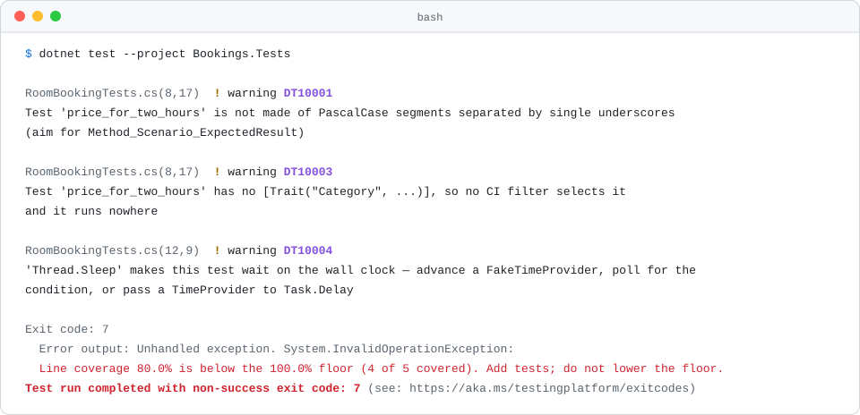

<h1 align="center">Testing rules</h1>

<p align="center">Every rule <code>Digitals.Testing</code> applies to a test project, why it exists, and what fixes it.</p>

<p align="center">
  
  
  
  
</p>

<p align="center">
  <a href="#how-to-read-a-rule">How to read a rule</a> ·
  <a href="#the-rules">The rules</a> ·
  <a href="#relaxed-in-tests">Relaxed in tests</a> ·
  <a href="#coverage-settings">Coverage settings</a> ·
  <a href="#change-a-rule-for-one-repo">Change a rule</a> ·
  <a href="../../README.md">Back to the README</a>
</p>

<p align="center">
  <picture>
    <source media="(prefers-color-scheme: dark)" srcset="../images/rules-testing-dark.svg">
    
  </picture>
</p>

`Digitals.Testing` is referenced only by test projects, so everything on this page applies to tests and never to
production code. It brings four kinds of check:

- Roslyn rules on test code. The `DT1####` rules are its own; `xUnit1004` comes from xUnit and is raised to a warning.
  They report as build warnings, and fail the build under `TreatWarningsAsErrors`, which Digitals.Analyzers requires.
- Two build checks, `DIGT001` and `DIGT002`, that fail the build with an error.
- A coverage gate that runs at the end of `dotnet test` and fails the run, with exit code 7, when coverage is below
  a floor or a method is past a limit.
- A test severity policy at `global_level 300`, which turns off the Digitals.Analyzers rules that are right for
  production code and wrong for tests.

Rule IDs from this package come from `DT1####`. Digitals.Analyzers keeps `DT0####`, so the two never collide in a
`#pragma` or an `.editorconfig`. `DT10002` was never allocated. Its rules are on [their own page](analyzers.md).

The examples edit one small, clean solution: a `Bookings` library with a `RoomBooking` for meeting rooms and studios,
and a `Bookings.Tests` project that references `Digitals.Testing` and nothing else. Moving a repo onto the package is
covered in the [adoption guide](../adoption/testing.md).

## How to read a rule

Every rule below has the same parts:

- Two badges.  means the rule runs in every project that references `Digitals.Testing`, and nowhere else. The second badge says where the rule comes from: Digitals or xUnit.
- Why the rule exists.
- A diff. The red lines fail the rule, the green lines pass it. For a coverage check the diff adds the test that was missing, and the output is what the run prints without it.
- What the build or `dotnet test` prints for the red lines, captured by running it. Paths are relative to the repo root, or to the package folder for its own targets file, and the project path MSBuild adds in square brackets to each line is left off.

## The rules

| Topic | Rules |
| --- | --- |
| [Test code](#test-code) | [`DT10001`](#dt10001) · [`DT10003`](#dt10003) · [`DT10004`](#dt10004) · [`DT10005`](#dt10005) · [`xUnit1004`](#xunit1004) |
| [Build checks](#build-checks) | [`DIGT001`](#digt001) · [`DIGT002`](#digt002) |
| [Coverage gate](#coverage-gate) | [`DigitalsMinLineCoverage`](#digitalsminlinecoverage) · [`DigitalsMinBranchCoverage`](#digitalsminbranchcoverage) · [`DigitalsMaxCrapScore`](#digitalsmaxcrapscore) · [`DigitalsMaxCyclomaticComplexity`](#digitalsmaxcyclomaticcomplexity) |

## Test code

### `DT10001`

 

A test name is PascalCase segments separated by single underscores. `Method_Scenario_ExpectedResult` is the shape to aim
for, so a failing test's name says what broke without opening the file. The number of segments is not checked:
`Price`, `Price_TwoHours` and `Price_TenHours_WhenOverTheDayRate_IsCapped` all pass, while `price_TwoHours`, `_Price`,
`Price_` and `Price__TwoHours` fail. The rule only looks at methods marked `[Fact]` or `[Theory]`, or an attribute
derived from them.

```diff
  [Fact]
- public void price_for_two_hours()
+ public void Price_TwoHours_IsTwiceTheRate()
  {
```

```text
Bookings.Tests/RoomBookingTests.cs(7,17): warning DT10001: Test 'price_for_two_hours' is not made of PascalCase segments separated by single underscores (aim for Method_Scenario_ExpectedResult) (https://github.com/Digitals-OYT-Ltd/csharp-conventions/blob/main/docs/rules/testing.md#dt10001)
```

### `DT10003`

 

Every test carries a `Category` trait, on the method or on its class. CI picks what to run by trait, with
`dotnet test -- --filter-trait "Category=Unit"`, so a test with no trait runs in no job at all. Nothing fails when that
happens, so nothing else reports it. The values are up to each repo; `digitals_testing.allowed_trait_values` pins them,
and `digitals_testing.required_trait` changes the trait's name (see [Options](#options)). A trait with an empty value
counts as no trait.

```diff
+ [Trait("Category", "Unit")]
  public sealed class RoomBookingTests
  {
      [Fact]
      public void Price_TwoHours_IsTwiceTheRate()
```

```text
Bookings.Tests/RoomBookingTests.cs(6,17): warning DT10003: Test 'Price_TwoHours_IsTwiceTheRate' has no [Trait("Category", ...)], so no CI filter selects it and it runs nowhere (https://github.com/Digitals-OYT-Ltd/csharp-conventions/blob/main/docs/rules/testing.md#dt10003)
```

> **Note:** With `digitals_testing.allowed_trait_values = Unit, Integration` set, a trait outside the list fails too:
>
> ```text
> Bookings.Tests/RoomBookingTests.cs(7,17): warning DT10003: Test 'Price_TwoHours_IsTwiceTheRate' has [Trait("Category", "Smoke")], which is not one of the values this repo allows (Unit, Integration) (https://github.com/Digitals-OYT-Ltd/csharp-conventions/blob/main/docs/rules/testing.md#dt10003)
> ```

### `DT10004`

 

No `Thread.Sleep`, and no `Task.Delay` without a `TimeProvider`. A sleep is a guess at how long something takes, made
on an idle laptop and run on a busy CI agent: too short and the test flakes, too long and the suite crawls. To move
time, advance a `FakeTimeProvider`, which the package brings in (namespace `Microsoft.Extensions.Time.Testing`). To wait for a
condition, poll with a deadline. Where a real delay is needed, `Task.Delay(delay, timeProvider, cancellationToken)`
takes a `TimeProvider` and passes. The rule covers every call in the project, fixtures and helpers included.

```diff
  [Fact]
  public void IsDue_AfterAMinute_IsTrue()
  {
-     var reminder = new BookingReminder(TimeProvider.System);
-     var start = DateTimeOffset.UtcNow.AddMinutes(16);
+     var clock = new FakeTimeProvider();
+     var reminder = new BookingReminder(clock);
+     var start = clock.GetUtcNow().AddMinutes(16);

-     Thread.Sleep(TimeSpan.FromMinutes(1));
+     clock.Advance(TimeSpan.FromMinutes(1));

      Assert.True(reminder.IsDue(start));
  }
```

```text
Bookings.Tests/BookingReminderTests.cs(12,9): warning DT10004: 'Thread.Sleep' makes this test wait on the wall clock — advance a FakeTimeProvider, poll for the condition, or pass a TimeProvider to Task.Delay (https://github.com/Digitals-OYT-Ltd/csharp-conventions/blob/main/docs/rules/testing.md#dt10004)
```

> **Note:** `await Task.Delay(TimeSpan.FromMinutes(1), TestContext.Current.CancellationToken)` in an `async Task` version of the test gets the same finding:
>
> ```text
> Bookings.Tests/BookingReminderTests.cs(12,15): warning DT10004: 'Task.Delay' makes this test wait on the wall clock — advance a FakeTimeProvider, poll for the condition, or pass a TimeProvider to Task.Delay (https://github.com/Digitals-OYT-Ltd/csharp-conventions/blob/main/docs/rules/testing.md#dt10004)
> ```

### `DT10005`

 

Every test reaches an assertion. A test that runs the code and checks nothing passes whatever the code does, and
coverage still counts its lines as tested. At a 100% floor that is the one way left to look tested without being
tested. The rule follows calls into any method declared in the test project, however deep, so a test that calls its
own `AssertPrice(booking, 90m)` passes. Methods from another assembly count only by name: any `Assert.*`, Verify.XunitV3.s
`Verify*`, NSubstitute.s `Received`, `ReceivedWithAnyArgs`, `DidNotReceive`, `DidNotReceiveWithAnyArgs` and
`Received.InOrder`, Roslyn's `AnalyzerTest.RunAsync`, and
whatever the repo adds in `digitals_testing.assertion_methods`. A test whose point is that nothing throws says so with
`Assert.Null(Record.Exception(...))`.

```diff
  [Fact]
  public void Price_TwoHours_IsTwiceTheRate()
  {
      var booking = new RoomBooking("Studio A", 2);

-     booking.Price(45m);
+     Assert.Equal(90m, booking.Price(45m));
  }
```

```text
Bookings.Tests/RoomBookingTests.cs(7,17): warning DT10005: Test 'Price_TwoHours_IsTwiceTheRate' reaches no assertion, so it passes whatever the code under test does; assert on the outcome, write a does-not-throw test as Assert.Null(Record.Exception(...)), or name an asserting harness in digitals_testing.assertion_methods (https://github.com/Digitals-OYT-Ltd/csharp-conventions/blob/main/docs/rules/testing.md#dt10005)
```

> **Note:** The rule reports once the whole compilation has been seen, because only then is it known whether a helper asserts. It shows on build and in CI, and in the IDE only with full solution analysis on. It replaces Sonar's `S2699`, which the package turns off because it can't see an assertion made inside a helper.

### `xUnit1004`

 

No skipped tests. xUnit ships this rule as Info, so a `Skip = "..."` added to get a build green stays unnoticed long
after anyone remembers why. The package raises it to a warning. Unskip the test or delete it. A test that should only
run on demand is `[Fact(Explicit = true)]`, which the rule does not flag.

```diff
- [Fact(Skip = "Fails on CI")]
+ [Fact]
  public void Price_TwoHours_IsTwiceTheRate()
  {
```

```text
Bookings.Tests/RoomBookingTests.cs(6,11): warning xUnit1004: Test methods should not be skipped. Remove the Skip property to start running the test again. (https://xunit.net/xunit.analyzers/rules/xUnit1004)
```

## Build checks

### `DIGT001`

 

The repo selects the Microsoft.Testing.Platform runner in `global.json`. Without it, `dotnet test` on .NET 10 goes
through the VSTest path: no coverage is collected and the coverage gate never runs, and neither failure mentions
coverage. This check names the cause instead. The runner setting needs .NET SDK 10 or later. The check reads the
nearest `global.json` in or above the test project's folder as text, looking for `Microsoft.Testing.Platform`.

```diff
  {
    "sdk": {
      "version": "10.0.100",
      "rollForward": "latestMinor"
-   }
+   },
+   "test": {
+     "runner": "Microsoft.Testing.Platform"
+   }
  }
```

```text
build/Digitals.Testing.targets(57,3): error DIGT001: Digitals.Testing requires the Microsoft.Testing.Platform runner, which is selected in global.json at the repository root. Add: "test": { "runner": "Microsoft.Testing.Platform" } (needs .NET SDK 10 or later). Without it no coverage is collected and the coverage gate never runs. Staging the migration? Set <DigitalsAllowVSTestRunner>true</DigitalsAllowVSTestRunner> with a comment explaining why.
```

> **Note:** This is what `dotnet build` prints. `dotnet test` stops before the build, with Microsoft.Testing.Platform's own error: `Testing with VSTest target is no longer supported by Microsoft.Testing.Platform on .NET 10 SDK and later.` `DigitalsAllowVSTestRunner` doesn't change that: it lets `dotnet build` pass while the `global.json` change waits, and `dotnet test` keeps failing until it lands.

### `DIGT002`

 

A test project doesn't reference a banned test package. Some duplicate what the package already brings, some belong to
the VSTest runner it replaces, and some pull xUnit v2 back into a v3 build. Each banned package in the project is
listed in one error. Only direct `PackageReference` items are checked; a banned package that arrives transitively is
not seen.

```diff
  <ItemGroup>
    <PackageReference Include="Digitals.Testing" />
-   <PackageReference Include="Moq" />
  </ItemGroup>
```

```text
build/Digitals.Testing.targets(68,3): error DIGT002: Banned test package(s) referenced: Moq (use NSubstitute). Legitimate exception? Set <DigitalsAllowBannedPackages>Moq</DigitalsAllowBannedPackages> with a comment explaining why.
```

| Instead of | Use |
| --- | --- |
| `Microsoft.NET.Test.Sdk` | Nothing. It is the VSTest host, and this package runs on Microsoft.Testing.Platform |
| `xunit.runner.visualstudio` | Nothing. It is the VSTest adapter, and xunit.v3 runs on Microsoft.Testing.Platform directly |
| `coverlet.collector`, `coverlet.msbuild` | Nothing. They only work under VSTest; coverage comes from `Microsoft.Testing.Extensions.CodeCoverage` |
| `Moq` | `NSubstitute` |
| `FluentAssertions` | xUnit's own `Assert.*`. Version 8 and later needs a commercial licence, and the frozen version 7 gets no security fixes |
| `xunit`, `xunit.core` | `xunit.v3` |
| `NUnit`, `MSTest`, `MSTest.TestFramework` | `xunit.v3` |
| `TngTech.ArchUnitNET.xUnit` | `TngTech.ArchUnitNET.xUnitV3` |
| `FsCheck.Xunit` | `FsCheck.Xunit.v3` |
| `Verify.Xunit` | `Verify.XunitV3` |
| `Microsoft.Playwright.Xunit` | `Microsoft.Playwright.Xunit.v3` |

The first four are the VSTest stack. Kept beside this package they cause `MTP0001` warnings, a coverage engine that
never runs, and a gate that enforces nothing. The last four are xUnit v2 integrations: their v2 IDs still resolve and
bring xUnit v2 back.

## Coverage gate

Every `dotnet test` collects coverage into a Cobertura report, and the gate judges it when the run ends. The gate
checks two run-wide floors and two per-method limits, and puts every failure in one message, which the run prints as
an unhandled `InvalidOperationException` before it exits with code 7. A run the gate passes prints nothing from the
gate; read `TestResults/*.cobertura.xml` to see the numbers.

The gate stays quiet when a test fails, because that run has already said why and its coverage is partial. It fails
when no Cobertura report was produced, because a gate that passes without data enforces nothing.

Each check has an MSBuild property, set in the test project. [Coverage settings](#coverage-settings) lists them with
their defaults and the switches that turn each check off.

### `DigitalsMinLineCoverage`

 

The share of coverable lines the tests run is at least this percentage, across the whole run. The default is 100: every
line someone wrote is run by a test, or is marked `[ExcludeFromCodeCoverage]` with a reason. Here `RoomBooking` has
gained a `Cancel()` method that no test calls.

```diff
      Assert.Equal(90m, booking.Price(45m));
  }
+
+ [Fact]
+ public void Cancel_NewBooking_IsCancelled()
+ {
+     var booking = new RoomBooking("Studio A", 2);
+
+     booking.Cancel();
+
+     Assert.True(booking.IsCancelled);
+ }
```

```text
Exit code: 7
  Error output: Unhandled exception. System.InvalidOperationException: Line coverage 80.0% is below the 100.0% floor (4 of 5 covered). Add tests; do not lower the floor.
```

### `DigitalsMinBranchCoverage`

 

The share of branches the tests take is at least this percentage, across the whole run. The default is 100. Line
coverage alone misses a condition written on one line: here `Price` caps a booking at eight hours with
`Hours > 8 ? hourlyRate * 8 : hourlyRate * Hours`, and the one test only books two hours, so every line runs and the
cap never does.

```diff
      Assert.Equal(90m, booking.Price(45m));
  }
+
+ [Fact]
+ public void Price_TenHours_IsCappedAtEightHours()
+ {
+     var booking = new RoomBooking("Studio A", 10);
+
+     Assert.Equal(360m, booking.Price(45m));
+ }
```

```text
Exit code: 7
  Error output: Unhandled exception. System.InvalidOperationException: Branch coverage 50.0% is below the 100.0% floor (1 of 2 covered). Add tests; do not lower the floor.
```

### `DigitalsMaxCrapScore`

 

No method scores above this CRAP (Change Risk Anti-Patterns) score. The floors are run-wide, so they can't see the one
untested method with a dozen branches inside a repo at 85%. CRAP is judged per method:
`complexity² × (1 − line coverage)³ + complexity`. A fully covered method scores its complexity; the same method with
no tests scores complexity² plus complexity, so covering it brings the score down fast. The default is 30. Here
`StudioRates.Surcharge` adds weekend and out-of-hours rates with three `if` statements on compound conditions, and nothing tests it.

```diff
+ [Trait("Category", "Unit")]
+ public sealed class StudioRatesTests
+ {
+     [Theory]
+     [InlineData("2026-11-04T10:00:00Z", 2, 0)]
+     [InlineData("2026-11-07T10:00:00Z", 2, 20)]
+     [InlineData("2026-11-08T07:00:00Z", 2, 35)]
+     [InlineData("2026-11-04T21:00:00Z", 9, 5)]
+     public void Surcharge_Start_AddsWeekendAndOutOfHoursRates(string start, int hours, int expected)
+     {
+         Assert.Equal(expected, StudioRates.Surcharge(DateTimeOffset.Parse(start), hours));
+     }
+ }
```

```text
Exit code: 7
  Error output: Unhandled exception. System.InvalidOperationException: 1 method(s) score above the CRAP limit of 30.0: Bookings.StudioRates.Surcharge(System.DateTimeOffset, int) scores 156.0 (complexity 12, 0 of 16 lines covered). Cover the branches or split the method; raising the limit is the last resort.
```

> **Note:** This run lowered both floors with `dotnet test -p:DigitalsMinLineCoverage=0 -p:DigitalsMinBranchCoverage=0`, as a repo with adoption floors would have them. With both floors at 100, a method passes them only when fully covered, and its score is then its complexity, which the complexity cap already holds to 20. So at the defaults this limit fails beside another check, and the message carries both:
>
> ```text
> Exit code: 7
>   Error output: Unhandled exception. System.InvalidOperationException: Line coverage 20.0% is below the 100.0% floor (4 of 20 covered). Branch coverage 0.0% is below the 100.0% floor (0 of 12 covered). Add tests; do not lower the floor. 1 method(s) score above the CRAP limit of 30.0: Bookings.StudioRates.Surcharge(System.DateTimeOffset, int) scores 156.0 (complexity 12, 0 of 16 lines covered). Cover the branches or split the method; raising the limit is the last resort.
> ```

### `DigitalsMaxCyclomaticComplexity`

 

No method is more complex than this, however well it is tested. At 100% coverage the CRAP score is the complexity, so
the CRAP limit alone would let a fully covered method reach 30. This cap holds it to 20, and coverage doesn't move it.
The number is read from the Cobertura report, where Microsoft's coverage engine counts about two per decision point:
five `if` statements in a row measure 10 and ten measure 20, so 20 is McCabe's 10 on this scale. A contiguous `switch`
counts one per arm. Read the number off the report rather than counting branches by eye. Here `ExtrasPricing.Price`
adds up eleven optional extras for a room, one `if` each, and its tests cover every branch.

```diff
  public static decimal Price(Extras extras)
- {
-     var total = 0m;
-     if (extras.HasFlag(Extras.Projector)) { total += 15m; }
-     if (extras.HasFlag(Extras.Whiteboard)) { total += 5m; }
-     // ...and nine more, one for each extra
-     return total;
- }
+     => Prices.Where(price => extras.HasFlag(price.Key)).Sum(price => price.Value);
```

```text
Exit code: 7
  Error output: Unhandled exception. System.InvalidOperationException: 1 method(s) are above the cyclomatic complexity limit of 20: Bookings.ExtrasPricing.Price(Bookings.Extras) has complexity 22. Split the method or flatten the branching; covering it does not help here.
```

`Prices` is a `Dictionary<Extras, decimal>` with one entry per extra. Both per-method limits name the five worst
methods and count the rest. Only code the coverage engine instruments is judged, so anything the coverage settings
exclude is outside both limits too. The engine also misses a contiguous `switch` behind an early-return guard: a
nine-arm dispatcher after `if (!verbose) { return "status"; }` reports a complexity of 2.

## Relaxed in tests

The test severity policy, [Digitals.Testing.globalconfig](../../src/Digitals.Testing/build/config/Digitals.Testing.globalconfig),
sits at `global_level 300`, above both of Digitals.Analyzers' configs, and turns these rules off in every test project.
They are right for production code and wrong for tests; production code keeps whatever severity Digitals.Analyzers
gives them. The reasons are the ones the file gives.

| Rule | Why it is off in tests |
| --- | --- |
| `CA1707` | No underscores in identifiers. `DT10001` requires them in test names, so the two would contradict each other. |
| `CA1515` | Make public types internal. xUnit needs test classes public, and a test project is an executable, so the rule is active there. |
| `DT00003` | No `new HttpClient()`. Building one over a stub handler is how a `DelegatingHandler` gets tested, and socket exhaustion and stale DNS don't apply to a test run. |
| `DT00013` | One abstraction level per method. A test repeats its act and assert steps on purpose. |
| `DT00014` | One abstraction level per method. A test builds its inputs in large initializers on purpose. |
| `DT00015` | One abstraction level per method. A test runs as long as its scenario needs. |
| `DT00016` | One abstraction level per method. A test builds its inputs field by field on purpose. |
| `DT00018` | One abstraction level per method. A test reads files and streams directly on purpose. `DT00017` stays on: tests check results with assertions, not an inline "if failed, throw". |
| `CA1822` | Mark members static. xUnit needs instance test methods. |
| `CA1852` | Seal internal types. Noise on fixtures and test doubles. |
| `CA2201` | No reserved exception types. Tests throw `Exception` on purpose. |
| `CA1869` | Cache `JsonSerializerOptions`. Creating them inline in a test is fine. |
| `CA2012` | Consume a `ValueTask` once. Relaxed for arrange and assert steps. |
| `CA1001` | A type with a disposable field implements `IDisposable`. Fixtures dispose in teardown. |
| `S2344` | Enum name suffix. Test enums. |
| `S4144` | Identical method bodies. Common in parameterised stubs. |
| `S3881` | The full `IDisposable` pattern. Test doubles skip it. |
| `S1172` | Unused parameter. `[Theory]` arguments and interface stubs keep them. |
| `IDE0060` | Unused parameter. The same reason as `S1172`. |
| `S1186` | Empty method. No-op fakes and stubs. |
| `S2701` | Boolean literal in an assertion. `Assert.True(true)` is fine. |
| `VSTHRD200` | The `Async` suffix. Test methods read as scenarios, not as async APIs. |
| `VSTHRD002` | Synchronous wait on a task. xUnit has no `SynchronizationContext`. |
| `VSTHRD003` | Awaiting a task started elsewhere. Concurrency tests await a shared `TaskCompletionSource` on purpose. |
| `CA1859` | Concrete return types for performance. Irrelevant in test helpers and builders. |
| `CS1591` | Missing XML comment. Test classes and methods are named, not documented. |
| `S2699` | No assertion in a test. It can't see an assertion made by a harness or a helper; [`DT10005`](#dt10005) replaces it. |
| `CS8600` | Nullable flow. Tests pass `null` on purpose to check null handling. |
| `CS8604` | Nullable flow. The same reason as `CS8600`. |
| `CS8625` | Nullable flow. The same reason as `CS8600`. |

The same file raises [`xUnit1004`](#xunit1004) from Info to warning, and sets the four `DT1####` rules to warning.

The package's targets file also drops Digitals.Analyzers' production-only ban list, so the
[raw SQL](analyzers.md#rs0030-raw-sql), [raw HTML](analyzers.md#rs0030-raw-html) and
[command line](analyzers.md#rs0030-command-lines) bans don't reach a test project. Test cleanup and schema checks run fixed SQL against table names built at runtime, which the parameterized
`FromSql` family can't express. The clock and millisecond bans stay on.

## Options

`DT10003` and `DT10005` read three settings from `.editorconfig`.

| Key | Default | What it does |
| --- | --- | --- |
| `digitals_testing.required_trait` | `Category` | The trait name `DT10003` requires. |
| `digitals_testing.allowed_trait_values` | Unset: any non-empty value passes | Comma-separated values the trait may take. Anything else fails `DT10003`. |
| `digitals_testing.assertion_methods` | Unset | Comma-separated methods `DT10005` counts as assertions, added to the defaults. Each is `Method`, `Type.Method` or `Namespace.Type.Method`; a trailing `*` matches by prefix. |

```ini
[*.cs]
digitals_testing.allowed_trait_values = Unit, Integration, Manual
digitals_testing.assertion_methods = Bookings.Testing.BookingHarness.Expect*, Snapshot.Match
```

The keys must sit under a section header such as `[*.cs]`. An `.editorconfig` ignores keys written above its first
section, and the rules then see no setting at all: `DT10003` goes back to accepting any value, and `DT10005` stops
recognising the harness.

## Coverage settings

Set these in the test project. The package reads them after the project file, so a value in the `.csproj` wins.

| Property | Default | What it does |
| --- | --- | --- |
| `DigitalsMinLineCoverage` | `100` | [The line floor](#digitalsminlinecoverage), a percentage. |
| `DigitalsMinBranchCoverage` | `100` | [The branch floor](#digitalsminbranchcoverage), a percentage. |
| `DigitalsMaxCrapScore` | `30` | [The CRAP limit](#digitalsmaxcrapscore), 1 or more. |
| `DigitalsMaxCyclomaticComplexity` | `20` | [The complexity cap](#digitalsmaxcyclomaticcomplexity), a whole number of 1 or more. |
| `DigitalsSkipCrapGate` | `false` | `true` turns off the CRAP limit and leaves the rest. |
| `DigitalsSkipComplexityGate` | `false` | `true` turns off the complexity cap and leaves the rest. |
| `DigitalsSkipCoverageGate` | `false` | `true` turns off the whole gate. Coverage is still collected, so the report is still written. |
| `DigitalsCoverageSettingsFile` | The packaged [Digitals.Testing.coverage.xml](../../src/Digitals.Testing/build/config/Digitals.Testing.coverage.xml) | The coverage engine's settings: what counts as coverable. A repo's own file replaces the packaged one, so start from a copy. |
| `DigitalsTrxReport` | `true` | Writes a TRX file to `TestResults/` for CI to publish. |

The packaged settings leave out assemblies whose name ends in `Tests`, auto-property bodies, code marked `[ExcludeFromCodeCoverage]`,
generated code, `[Obsolete]` code and EF Core migrations. Mark code that genuinely can't be tested with
`[ExcludeFromCodeCoverage(Justification = "...")]`; it then leaves the denominator.

The floors and limits are a ratchet. A repo adopting the package usually lands below the defaults, so set each one
once, to what the repo has today, next to a comment naming the work that brings it back. After that, move it only
towards the default. To find today's numbers, let the gate fail and read them from the message; the
[adoption guide](../adoption/testing.md#setting-the-coverage-floor) walks through it.

```xml
<!-- ADOPTION FLOOR: back to 100 once the booking API has tests (TICKET-1234). -->
<DigitalsMinLineCoverage>71</DigitalsMinLineCoverage>
<DigitalsMinBranchCoverage>58</DigitalsMinBranchCoverage>
```

Use `DigitalsSkipCoverageGate` for a suite where the number means nothing, such as a smoke-test or contract-test
project, not to get past a floor.

## Change a rule for one repo

A repo-local `.editorconfig` beats the packaged globalconfig. Set a rule's severity under a section, with a comment
saying why:

```ini
[*.cs]
# Test names follow the RFC sections they cover.
dotnet_diagnostic.DT10001.severity = none
```

A narrower section scopes it to some files, such as an integration fixture that needs real delays:

```ini
[tests/Bookings.IntegrationTests/**.cs]
# Polls a real message broker that has no TimeProvider.
dotnet_diagnostic.DT10004.severity = none
```

For one place in the code, use a `#pragma` with the reason on the same line:

```csharp
#pragma warning disable DT10004 // Waits for the broker's own retry interval.
Thread.Sleep(TimeSpan.FromSeconds(1));
#pragma warning restore DT10004
```

The build checks and the coverage gate are MSBuild properties, set in the test project with a comment saying why:

```xml
<!-- Moq stays until the payment client tests move to NSubstitute (TICKET-1240). -->
<DigitalsAllowBannedPackages>Moq</DigitalsAllowBannedPackages>

<!-- global.json moves to the MTP runner with the SDK upgrade (TICKET-1241); remove then. -->
<DigitalsAllowVSTestRunner>true</DigitalsAllowVSTestRunner>
```

`DigitalsAllowBannedPackages` takes several packages separated by semicolons. `DigitalsAllowVSTestRunner` only stages
a migration: it lets `dotnet build` pass, but `dotnet test` still fails until `global.json` selects the runner, and no
coverage is collected meanwhile. The coverage properties are in
[Coverage settings](#coverage-settings).
